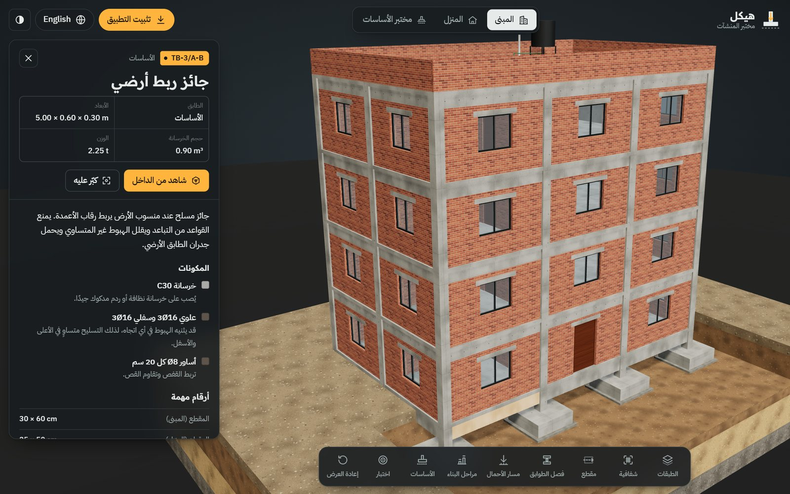
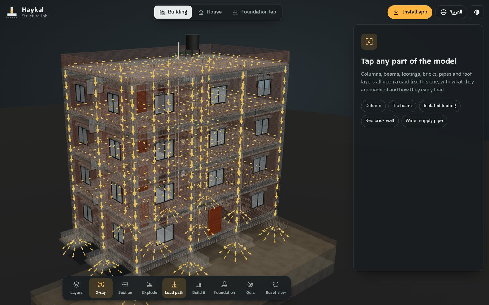
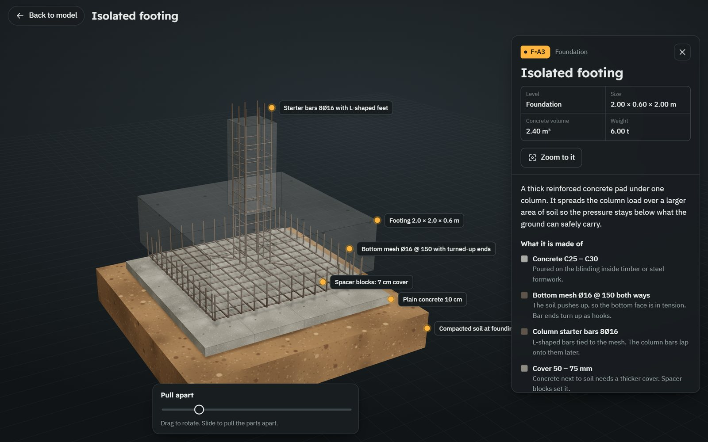
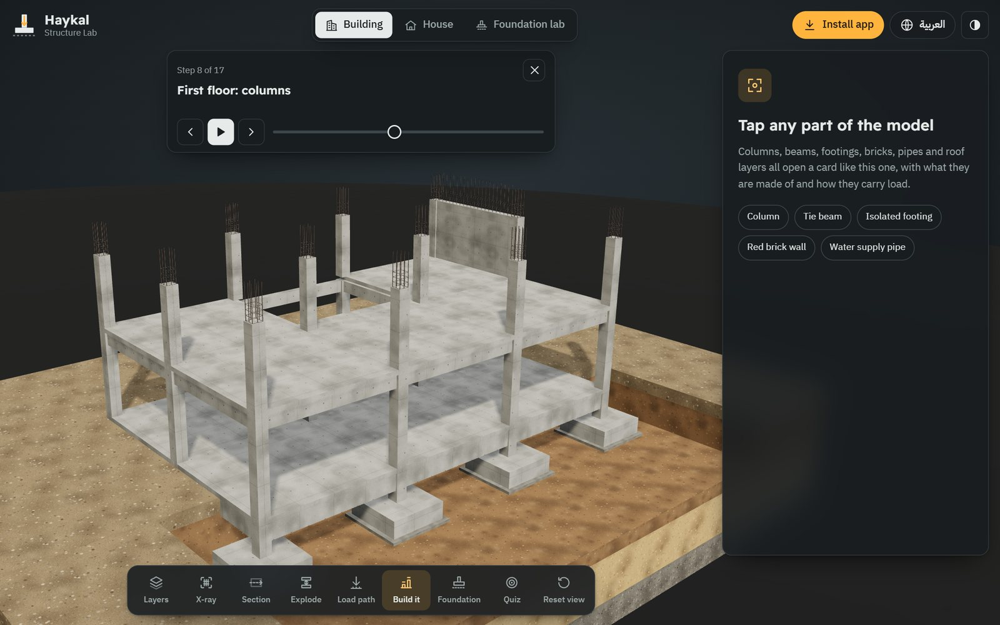
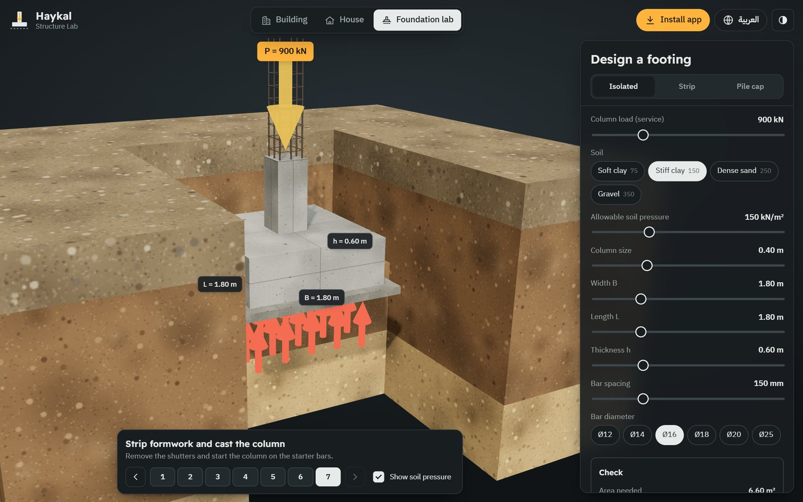
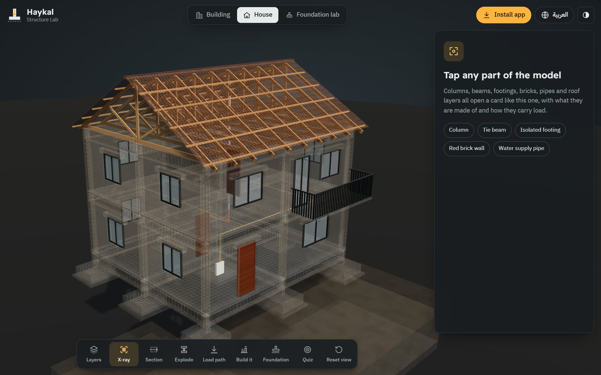
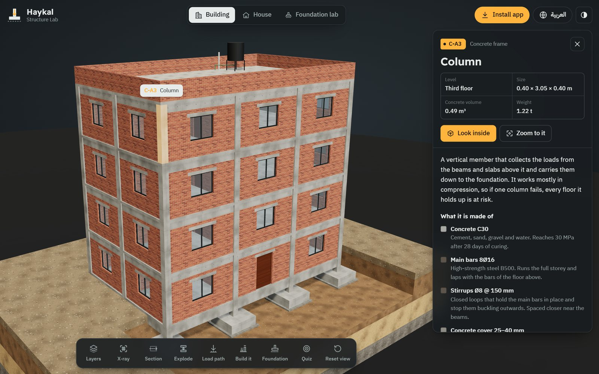
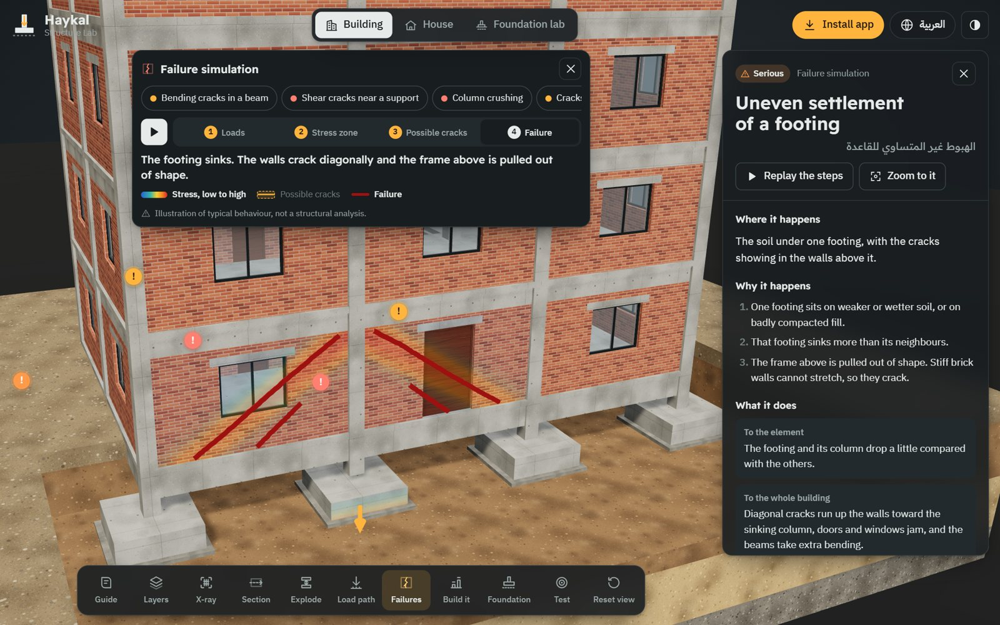
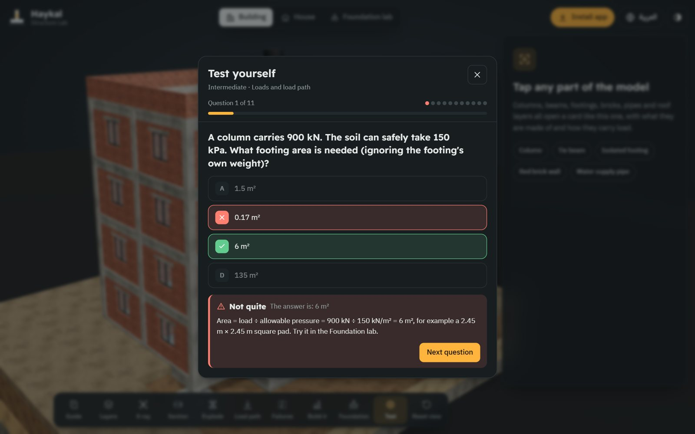
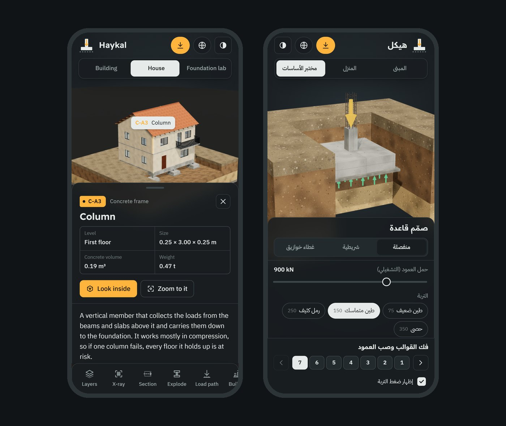

# هيكل

**مختبر المنشآت** | Haykal Structure Lab 
دليل تفاعلي ثلاثي الأبعاد يشرح كيف تقف المباني، لطلاب الهندسة المدنية 
بواسطة **فريق حوار**

[English](README.md) | [العربية](README.ar.md)

### [▶ افتح التطبيق](https://iimaster12.github.io/haykal-app/) | [⬇ تحميل النسخة دون إنترنت](https://github.com/iimaster12/haykal-app/releases/latest)

 

<table>
  <tr>
    <td align="center" width="16%"><h2>2</h2>نموذجان ثلاثيا الأبعاد</td>
    <td align="center" width="16%"><h2>37</h2>عنصرًا يمكن لمسه</td>
    <td align="center" width="16%"><h2>18</h2>عرضًا تفصيليًا</td>
    <td align="center" width="16%"><h2>4</h2>أنظمة أساسات</td>
    <td align="center" width="16%"><h2>17</h2>مرحلة بناء</td>
    <td align="center" width="16%"><h2>2</h2>لغتان</td>
  </tr>
</table>

## ماذا يستطيع الطالب أن يفعل

كل عمود وجائز وقاعدة وجدار طوب وأنبوب وطبقة من طبقات السطح يفتح بطاقة فيها: مكوناته، والأرقام المهمة، وكيف ينقل الحمل، والخطأ الأكثر شيوعًا في الموقع. وعند التكبير على أي عنصر تتلاشى الخرسانة تدريجيًا لترى حديد التسليح داخلها.

| | |
|---|---|
|  **مسار الأحمال والشفافية.** أسهم كهرمانية تنتقل من البلاطات إلى الجوائز ثم عبر الأعمدة إلى التربة. |  **شاهد من الداخل.** فكّك العنصر: شبكة القاعدة، قضبان الانتظار، الأساور، الطوب، وصلات الأنابيب، طبقات السطح. |
|  **مراحل البناء.** شاهد المبنى يرتفع خطوة بخطوة، التسليح أولًا ثم صب الخرسانة. |  **مختبر الأساسات.** حدّد الحمل ونوع التربة وأبعاد القاعدة، وشاهد أسهم الضغط تتحول إلى الأحمر عندما تكون القاعدة صغيرة. |
|  **المنزل.** جملونات خشبية للسقف، وشرفة ناتئة، وجدران من الطوب الخرساني، وأنابيب المياه والكهرباء داخل البلاطة. |  **بالإنجليزية أيضًا.** زر واحد يبدّل الواجهة كاملة بين العربية والإنجليزية. |
|  **عندما يحدث الانهيار.** سبع حالات معتادة، من شقوق الانحناء والقص إلى هبوط القاعدة. تُعرض كل حالة في أربع خطوات (الأحمال، منطقة الإجهاد، الشقوق المحتملة، الانهيار) مع بطاقة تشرح السبب والأثر على المبنى ومخطط القوى. وهي رسوم تعليمية توضيحية وليست تحليلًا إنشائيًا. |  **الدليل والاختبار.** دليل خطوة بخطوة يبدأ من التربة حتى البلاطة بلغة بسيطة، واختبار بمستويين مبتدئ ومتوسط يشرح كل إجابة وينتهي بنتيجة حسب الموضوع. |

وفي شريط الأدوات أيضًا: مقاطع أفقية وأمامية، وفصل الطوابق، وإظهار الطبقات وإخفاؤها، واختيار نوع الأساسات (منفصلة أو شريطية أو حصيرية أو خوازيق).

## ثبّته على أي جهاز

| الجهاز | طريقة الحصول عليه |
|---|---|
| [**آيفون وآيباد**](https://iimaster12.github.io/haykal-app/install.html#ios) | افتح رابط التطبيق في Safari، ثم زر المشاركة، ثم **إضافة إلى الشاشة الرئيسية** |
| [**أندرويد**](https://iimaster12.github.io/haykal-app/install.html#android) | افتح الرابط في Chrome واضغط **تثبيت التطبيق**، أو [حمّل ملف APK](https://github.com/iimaster12/haykal-app/releases/latest/download/Haykal.apk) |
| [**ويندوز**](https://iimaster12.github.io/haykal-app/install.html#windows) | افتح الرابط في Edge أو Chrome واضغط **تثبيت التطبيق** |
| [**ماك**](https://iimaster12.github.io/haykal-app/install.html#mac) | افتح الرابط في Chrome أو Edge واضغط **تثبيت التطبيق**، أو في Safari اختر ملف ← إضافة إلى Dock |
| [**لينكس وكروم أو إس**](https://iimaster12.github.io/haykal-app/install.html#linux) | افتح الرابط في Chrome واضغط **تثبيت التطبيق** |
| [**حاسوب دون إنترنت**](https://github.com/iimaster12/haykal-app/releases/latest/download/Haykal-offline.html) | حمّل `Haykal-offline.html` وافتحه بنقرتين |

اضغط على جهازك لترى خطوات مصوّرة بالتفصيل. بعد التثبيت يظهر «هيكل» بأيقونته، ويفتح بملء الشاشة، ويعمل دون إنترنت.

## المحتوى

- الأرقام مبنية على الممارسة الشائعة لهيكل سكني من الخرسانة المسلحة، والمراجعات التصميمية مبنية على قواعد تقريبية من الكود ACI 318.
- المصطلحات العربية فصيحة ومعتمدة يفهمها أي طالب عربي، دون لهجة بلد بعينه.
- مختبر الأساسات يراجع ضغط التربة وقص الاختراق والتسليح السفلي ويحسب كميات الخرسانة والفولاذ. هذه مراجعات مبسطة للتعلم، والتصميم الحقيقي يحتاج إلى مهندس مرخّص.

## الترخيص

جميع الحقوق محفوظة © 2026 iimaster12.

ينشر هذا المستودع التطبيق الجاهز لاستخدامه وتثبيته، وهو ليس مفتوح المصدر: يمكنك استخدام التطبيق للتعلم والتدريس، لكن لا يجوز نسخ شيفرته أو محتواه أو تعديلهما أو إعادة توزيعهما. انظر [LICENSE](LICENSE).

