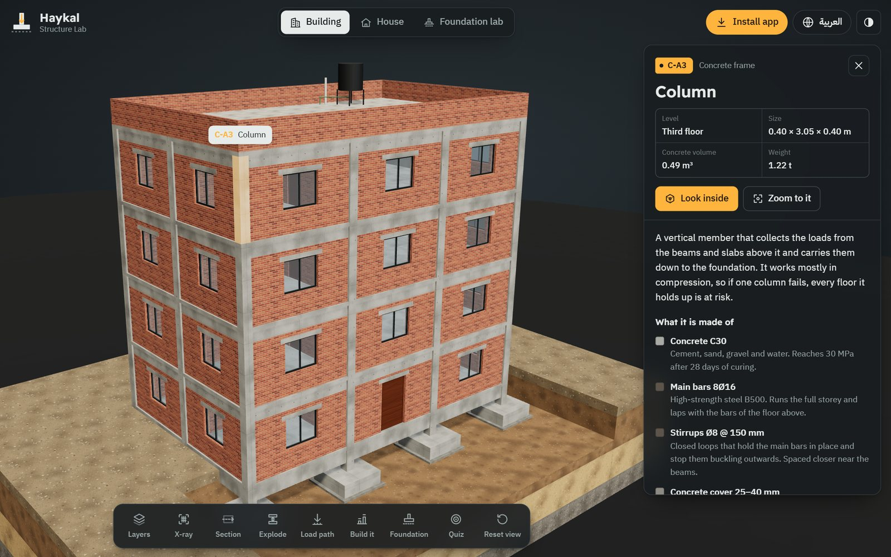
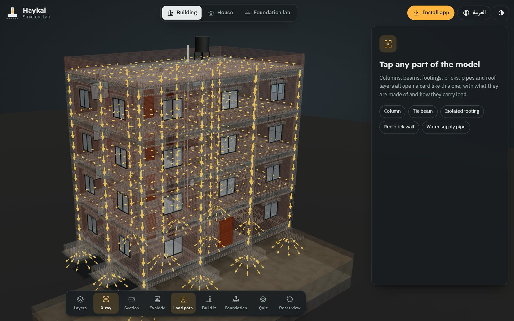
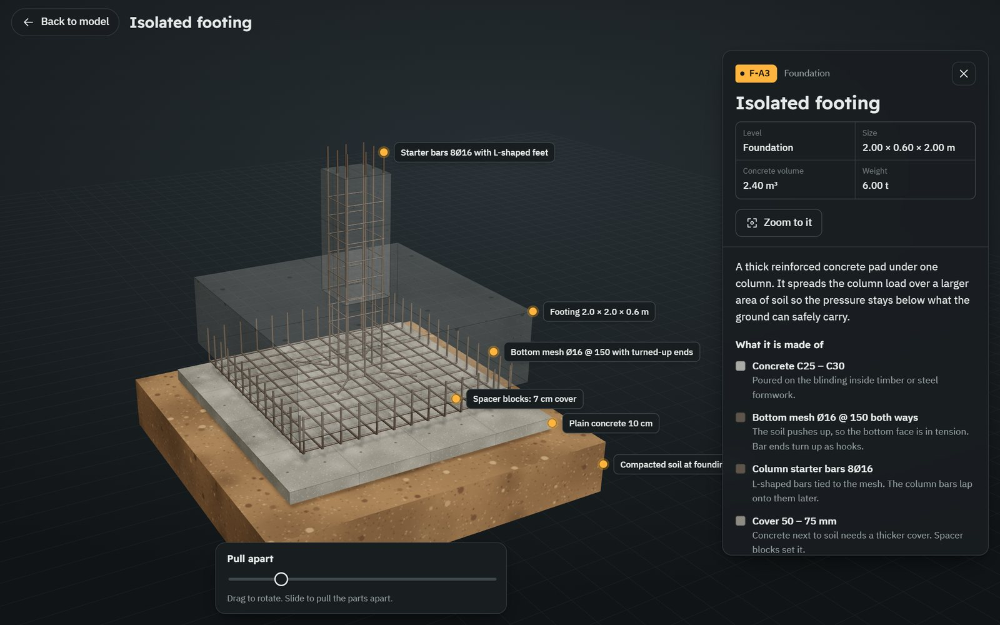
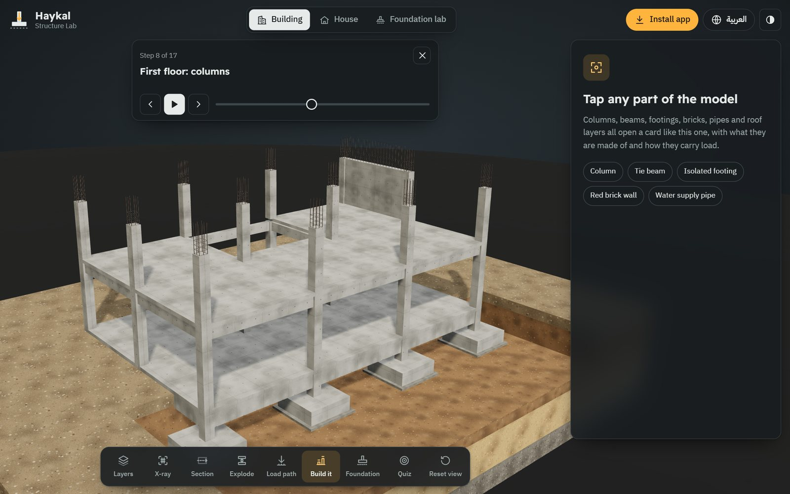
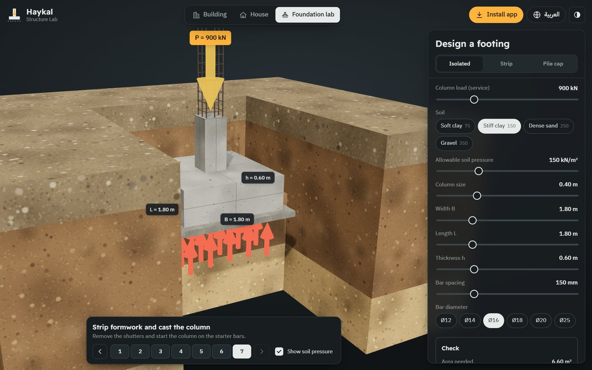
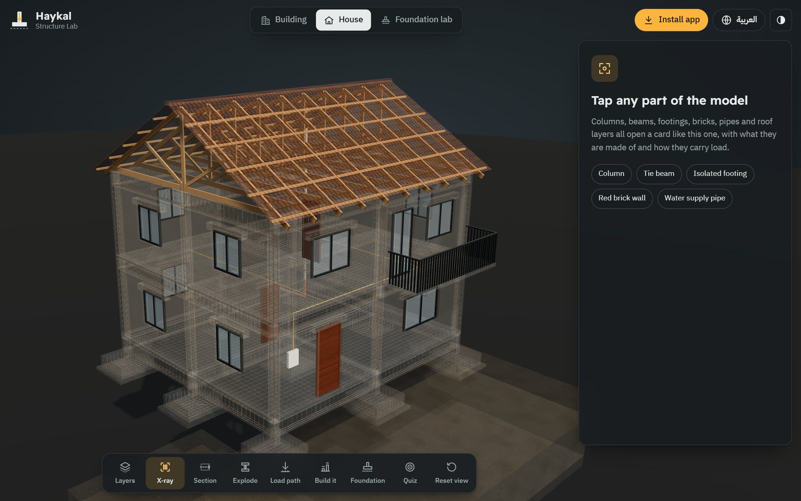
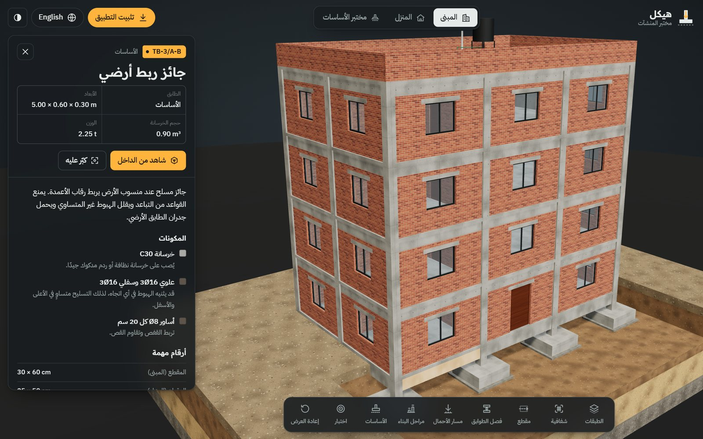
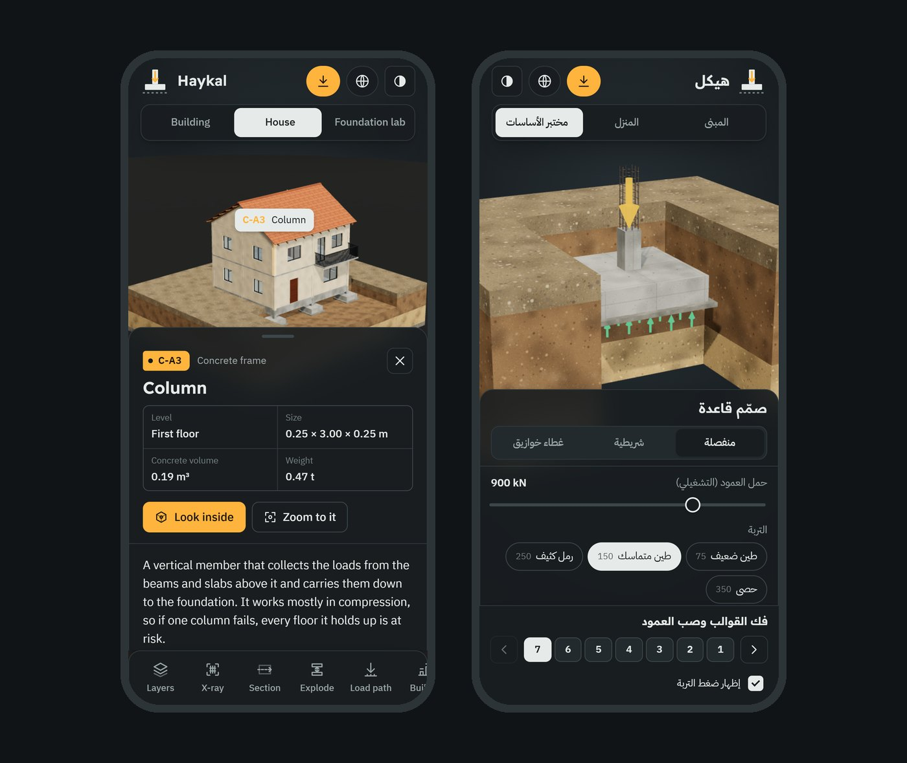

# Haykal Structure Lab

**هيكل** 
An interactive 3D guide to how buildings stand up, for civil engineering students

[English](README.md) | [العربية](README.ar.md)

 

 

  

<table>
  <tr>
    <td align="center" width="16%"><h2>2</h2>3D models</td>
    <td align="center" width="16%"><h2>37</h2>parts you can tap</td>
    <td align="center" width="16%"><h2>18</h2>close-up studies</td>
    <td align="center" width="16%"><h2>4</h2>foundation systems</td>
    <td align="center" width="16%"><h2>17</h2>build steps</td>
    <td align="center" width="16%"><h2>2</h2>languages</td>
  </tr>
</table>

## What students can do

Every column, beam, footing, brick wall, pipe and roof layer opens a card: what it is made of, the numbers that matter, how it carries load, and the mistake people most often make on site. Zoom in close and the concrete fades away so you can see the steel inside.

<table>
  <tr>
    <td width="50%"> <b>Load path and X-ray.</b> Amber arrows run from the slabs into the beams, down every column and out into the soil.</td>
    <td width="50%"> <b>Look inside.</b> Pull an element apart: footing mesh, starter bars, stirrups, bricks, pipe joints, roof layers.</td>
  </tr>
  <tr>
    <td width="50%"> <b>Build it.</b> Watch the building go up step by step, steel first, then the concrete pour.</td>
    <td width="50%"> <b>Foundation lab.</b> Set the load and the soil, size a footing, and see the pressure arrows turn red when it is too small.</td>
  </tr>
  <tr>
    <td width="50%"> <b>The house.</b> Timber roof trusses, a cantilever balcony, block walls, plumbing and wiring inside the slab.</td>
    <td width="50%"> <b>Full Arabic.</b> The whole interface mirrors right to left, with standard Arabic engineering terms.</td>
  </tr>
</table>

Also in the toolbar: section cuts in plan or elevation, floors pulled apart, layer switches (soil, foundation, frame, walls, openings, services, roof), a choice of isolated, strip, raft or pile foundations, and a "find the part" quiz.

## Install it on any device

Open **https://iimaster12.github.io/haykal-app/** and install it:

| Device | Browser | How to install |
|---|---|---|
| iPhone, iPad | Safari | Tap Share, then **Add to Home Screen** |
| Android | Chrome | Tap **Install app** at the top of Haykal |
| Windows, macOS, Linux, ChromeOS | Chrome or Edge | Click **Install app** at the top of Haykal, or the install icon in the address bar |
| A laptop with no internet | any | Download `Haykal-offline.html` from the [latest release](https://github.com/iimaster12/haykal-app/releases/latest) and double-click it |

Once installed it has its own icon, opens full screen and keeps working offline. More detail is in the [install guide](HOW-TO-INSTALL.md).

## Content

- Numbers follow common practice for a residential reinforced concrete frame, with design checks based on ACI 318 rules of thumb.
- Arabic uses standard technical terms that any Arab student will recognise, not one country's site slang.
- The foundation lab checks bearing pressure, punching shear (one-way shear for strips) and bottom steel, and gives concrete and steel quantities. These are simplified checks for learning. A real design needs a licensed engineer.

## How it is built

Plain HTML, CSS and JavaScript with [three.js](https://threejs.org) r160. Every model, texture and rebar cage is generated in code when the page loads, so there are no 3D files to download; the app's own code is about 300 KB. A service worker keeps a copy of every file for offline use.

## License

Copyright © 2026 iimaster12. All rights reserved.

This repository publishes the finished app so it can be used and installed. It is not open source: you may use the app to learn and teach, but you may not copy, modify or redistribute its code or content. See [LICENSE](LICENSE). three.js is used under the MIT License and the fonts under the SIL Open Font License; their license texts are in `vendor/three/` and `fonts/`.
